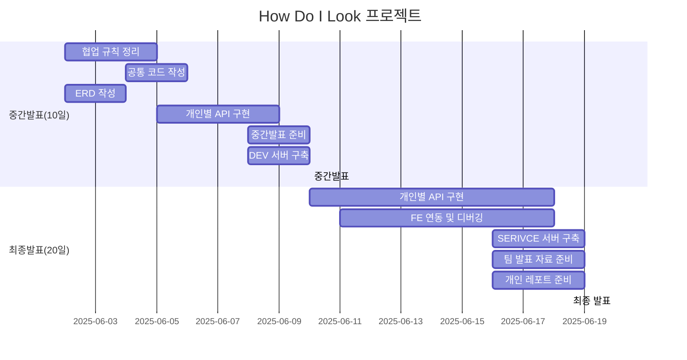
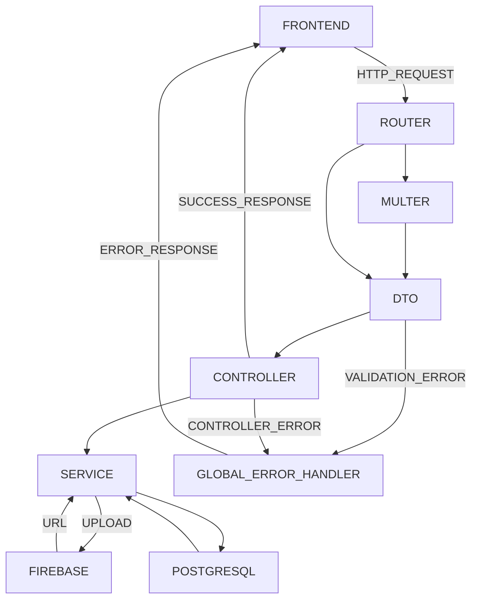

# TEAM 1

**팀 위키**: [깃허브 위키](https://github.com/gyunam-bark/nb02-how-do-i-look-team1/wiki)

**팀 이슈**: [깃허브 이슈](https://github.com/gyunam-bark/nb02-how-do-i-look-team1/issues?q=is%3Aissue%20state%3Aclosed)

**팀 PR**: [깃허브 PR](https://github.com/gyunam-bark/nb02-how-do-i-look-team1/pulls?q=is%3Apr+is%3Aclosed)

## 팀원 구성

|  이름  | 역할 | 담당 업무                                                                                                                                      | 깃허브                                                                 |
| :----: | :--: | ---------------------------------------------------------------------------------------------------------------------------------------------- | ---------------------------------------------------------------------- |
| 박규남 | 팀장 | PM, Tag API, Log Api, Health Check API, DTO 미들웨어, Global Error Handler 미들웨어, PR-디스코드 연동, 이슈-구글 시트 연동, Swagger 연동, 배포 | [https://github.com/gyunam-bark](https://github.com/gyunam-bark)       |
| 권나현 | 팀원 | Style API, Prisma Schema 설계, Seed 데이터 설계 및 작성                                                                                        | [https://github.com/kwonnahyun0125](https://github.com/kwonnahyun0125) |
| 김슬비 | 팀원 | Curation API                                                                                                                                   | [https://github.com/stella62420](https://github.com/stella62420)       |
| 김진솔 | 팀원 | Image API, Ranking API, Prisma Schema 설계                                                                                                     | [https://github.com/JINSOLdev](https://github.com/JINSOLdev5)          |
| 하상준 | 팀원 | Comment API, 비밀번호 해싱/비교 유틸리티                                                                                                       | [https://github.com/hippo8427](https://github.com/hippo8427)           |

---

## 프로젝트 소개

- 스타일 공유 및 큐레이팅 서비스 백엔드 시스템 구축

- **프로젝트 기간**: 2025.06.02 ~ 2025.06.20



---

## 기술 스택

|     분류     | 사용 도구                                                                             |
| :----------: | ------------------------------------------------------------------------------------- |
|    백엔드    | node.js, express.js                                                                   |
|     ORM      | prisma                                                                                |
| 데이터베이스 | postgresql                                                                            |
|  API 문서화  | swagger                                                                               |
|  협업 도구   | git, github, discord                                                                  |
|  일정 관리   | github webhook, google run function, google apps script, google spreadsheet           |
| 설치 패키지  | dotenv, morgan, multer, cors, bcrypt, superstruct, firebase-admin, swagger-ui-express |
|   스토리지   | google firebase                                                                       |
|     배포     | render.com(프론트엔드,백엔드,데이터베이스)                                            |

## 로컬 실행

Node.js 22.15.0 이상에서 아래 명령으로 의존성을 설치하고 개발 서버를 실행합니다.

```bash
npm install
npm run dev
```

`.env`에 `DATABASE_URL`을 설정해야 데이터베이스 API를 사용할 수 있습니다. 이미지 업로드를 사용하려면
`FIREBASE_CONFIG`에 Firebase 서비스 계정 JSON도 설정하세요. 기본 개발 포트는 `5050`입니다.

## 옷 이미지 분석

`POST /images/analyze`에 이미지 한 장을 보내면 Meta Model API가 옷의 종류, 색상, 특징을 한국어로 분석합니다.
`.env`의 `MODEL_API_KEY`가 필요하며, `MODEL_NAME`으로 모델을 선택할 수 있습니다(기본값: `muse-spark-1.3`).

요청은 `multipart/form-data`의 `image` 필드에 JPEG, PNG 또는 WebP 파일 한 장을 첨부합니다.
파일 크기는 최대 8 MiB(8,388,608 bytes)이며, 파일 내용도 형식과 일치해야 합니다. 위치 좌표는 필요하지 않습니다.
이미지 바이트는 메모리에서 Base64로 변환해 Meta에 전달하며, 이 API는 파일·분석 결과를 저장하거나 Firebase·DB에 접근하지 않습니다.

```bash
curl -X POST http://localhost:5050/images/analyze \
  -F 'image=@/path/to/clothes.jpg;type=image/jpeg'
```

성공 응답(`200 OK`) 예시:

```json
{
  "summary": "흰색 긴팔 셔츠 한 벌이 보입니다.",
  "closetItems": [
    {
      "category": "상의",
      "color": "흰색",
      "description": "앞면에 단추와 칼라가 있는 긴팔 셔츠"
    }
  ]
}
```

옷이 보이지 않거나 식별하기 어려우면 `closetItems`는 빈 배열이고 `summary`에 이유를 반환합니다.
날씨에 따른 코디 추천은 이 분석 API의 응답에 포함하지 않습니다.

실패 응답은 `{ "message": "오류 설명" }` 형식입니다.

| 상태 코드 | 원인 |
| --- | --- |
| `400` | 파일 누락, 복수 파일, 잘못된 필드·MIME 형식 또는 이미지 내용 |
| `413` | 파일 크기 8 MiB 초과 |
| `502` | 모델 API 연결·응답 오류 또는 유효하지 않은 분석 결과 |
| `503` | API 키 미설정 또는 모델 API의 인증·권한·요청 제한(`401`, `403`, `429`) |
| `504` | 모델 API 요청이 30초 안에 완료되지 않음 |

연동 방식은 Meta 공식 [이미지 이해 문서](https://dev.meta.ai/docs/media-understanding)의 Base64 이미지 입력과
[구조화된 출력 문서](https://dev.meta.ai/docs/structured-output)의 JSON Schema 응답을 따릅니다.

## 날씨 기반 코디 평가와 추가 아이템 추천

`POST /recommendations/outfit`에 코디 이미지와 위치 좌표를 보내면 서버가 해당 지역의 날씨를 조회하고,
이미지와 날씨를 함께 Meta에 전달해 코디의 적합성과 추가하면 좋은 옷·액세서리를 추천합니다.
`/weather`나 `/images/analyze`를 먼저 호출할 필요는 없습니다. 파일과 추천 결과는 저장하지 않으며 Firebase·DB에 접근하지 않습니다.

`.env`에 `OPENWEATHER_API_KEY`와 `MODEL_API_KEY`를 설정하세요.
기존 `OPENWEATHER_UNITS`, `OPENWEATHER_LANG`, `MODEL_NAME` 설정이 적용됩니다.
날씨는 OpenWeather가 반환한 예보 중 해당 지역의 오늘 날짜에 속하는 남은 시간대의 요약이며,
이미 지난 시간대를 포함한 하루 전체 관측값은 아닙니다.

Postman에서는 `POST http://localhost:5050/recommendations/outfit`을 선택하고 **Body → form-data**에 아래 값을 추가합니다.
필드 순서는 상관없으며 `Content-Type`은 Postman이 자동 설정하도록 두세요.

| Key | Type | 값 |
| --- | --- | --- |
| `image` | File | JPEG·PNG·WebP 코디 이미지 한 장, 최대 8 MiB |
| `latitude` | Text | 위도, -90~90 (예: `37.5665`) |
| `longitude` | Text | 경도, -180~180 (예: `126.978`) |

```bash
curl -X POST http://localhost:5050/recommendations/outfit \
  -F 'image=@/path/to/outfit.jpg;type=image/jpeg' \
  -F 'latitude=37.5665' \
  -F 'longitude=126.978'
```

성공 응답(`200 OK`) 예시:

```json
{
  "weather": {
    "location": "Seoul",
    "date": "2026-11-16",
    "description": "맑음",
    "minTemperature": 8,
    "maxTemperature": 15,
    "feelsLikeMin": 6,
    "feelsLikeMax": 14,
    "humidity": 55,
    "maxWindSpeed": 3,
    "precipitationProbability": 20,
    "temperatureUnit": "°C",
    "windSpeedUnit": "m/s"
  },
  "closetItems": [
    { "category": "상의", "color": "흰색", "description": "칼라와 단추가 있는 긴팔 셔츠" },
    { "category": "하의", "color": "파란색", "description": "발목까지 내려오는 청바지" }
  ],
  "suitability": {
    "status": "needs_adjustment",
    "reason": "긴팔 셔츠와 긴바지는 낮에 입기 좋지만, 체감 기온이 낮아지는 시간대에는 겉옷이 필요합니다.",
    "concerns": ["체감 최저 기온 6°C에서 상체가 추울 수 있습니다."]
  },
  "additionalItems": [
    {
      "category": "아우터",
      "name": "가벼운 재킷",
      "color": "네이비",
      "reason": "낮은 체감 기온과 바람에 대비하기 좋습니다.",
      "stylingTip": "흰색 셔츠 위에 걸치고 더워지면 벗어 휴대하세요."
    }
  ],
  "outfits": [
    {
      "name": "재킷을 더한 데일리 코디",
      "items": ["흰색 긴팔 셔츠", "파란색 청바지", "추천 아이템: 네이비 가벼운 재킷"],
      "reason": "기존 코디에 보온할 수 있는 겉옷을 더해 체감 기온 변화에 대응합니다.",
      "tips": "기온이 높은 시간대에는 재킷을 벗어 조절하세요."
    }
  ],
  "weatherAdvice": "낮은 체감 기온에 대비해 겉옷을 챙기세요."
}
```

`closetItems`에는 사진에서 확인한 아이템만 포함하고, `additionalItems`에는 추가를 제안하는 아이템을 최대 5개 반환합니다.
`outfits`는 기존 아이템과 추천 아이템을 조합한 코디 예시이며, 추가할 필요가 없으면 `additionalItems`는 빈 배열입니다.
사진만으로 확인하기 어려운 소재·보온성·방수 성능은 단정하지 않습니다.

| `suitability.status` | 의미 |
| --- | --- |
| `suitable` | 해당 날씨에 적합 |
| `needs_adjustment` | 겉옷·액세서리 등 보완 필요 |
| `unsuitable` | 날씨에 맞게 코디 변경 필요 |
| `unknown` | 사진이나 정보가 부족해 판단하기 어려움 |

옷을 식별할 수 없으면 `status`는 `unknown`이고, `closetItems`, `additionalItems`, `outfits`는 빈 배열입니다.
그 이유는 `suitability.reason`에 반환합니다.

실패 응답은 `{ "message": "오류 설명" }` 형식입니다.

| 상태 코드 | 원인 |
| --- | --- |
| `400` | 이미지·좌표 누락, 잘못된 좌표, 이미지 필드·형식·내용 오류 또는 복수 파일 |
| `413` | 파일 크기 8 MiB 초과 |
| `502` | 날씨·모델 API 연결·응답 오류 또는 유효하지 않은 추천 결과 |
| `503` | API 키 미설정, 날씨 API 인증 실패(`401`), 모델 API 인증·권한·요청 제한(`401`, `403`, `429`) |
| `504` | 날씨 API(10초) 또는 모델 API(30초) 요청 시간 초과 |

---

## 백엔드 서비스 흐름



## 팀원별 구현 기능 상세

### 박규남


- [개인 개발 보고서](https://github.com/gyunam-bark/nb02-how-do-i-look-report)

**CI/CD**

- Github Issue 와 Google Spreadsheet 연동

  - Issue 생성 시 팀 Gantt 시트 실시간 업데이트를 위한 연동
  - [이슈 템플릿 문서](./.github/ISSUE_TEMPLATE/todo-template.md)
  - Github Issue -> Google Run Function
  - Google Run Function(Node.ts, Axios) -> Google Apps Script
  - Google Apps Script -> Google Spreadsheet

- Github PR 과 Discord 연동

  - PR 생성 시 팀 디스코드에 알림(@맨션) 을 하기 위한 연동
  - [PR 템플릿 문서](./.github/PULL_REQUEST_TEMPLATE.md)
  - [PR 깃허브 액션](./.github/workflows/pr-to-discord.yml)
  - Github PR -> Github Actions
  - Github Actions -> Discord

**API**

- Tag(/tags)

  - 태그 목록을 받기 위한 API
  - [라우터 코드](./src/routes/tag-route.ts)
  - [컨트롤러 코드](./src/controllers/tag-controller.ts)
  - [서비스 코드](./src/services/tag-service.ts)
  - 요청 예시

    ```json

    ```

  - 응답 예시
    ```json
    {
      "tags": ["string"]
    }
    ```

- Log(/logs)

  - 데이터베이스에 저장된 에러 로그 목록을 받기 위한 API
  - [라우터 코드](./src/routes/log-route.ts)
  - [컨트롤러 코드](./src/controllers/log-controller.ts)
  - [서비스 코드](./src/services/log-service.ts)
  - [스키마](./prisma/schema.prisma#L118-L126)
  - 요청 예시

    ```json

    ```

  - 응답 예시
    ```json
    {
      "totalItemCount": 0,
      "data": [
        {
          "id": 1,
          "ip": "string",
          "url": "string",
          "method": "string",
          "statusCode": "string",
          "message": "string",
          "createdAt": "2025-06-18T01:02:32.664Z"
        }
      ]
    }
    ```

- Health Check(/)

  - 서버 헬스체크를 위한 API
  - [라우터 코드](./src/routes/root-route.ts)
  - [컨트롤러 코드](./src/controllers/root-controller.ts)
  - 요청 예시

    ```json

    ```

  - 응답 예시

    ```json
    {
      "status": "OK",
      "uptime": 0,
      "timestamp": "2025-06-18T01:02:32.664Z"
    }
    ```

**MIDDLEWARE**

- DTO

  - 파라미터를 검증하고, 필요에 따라 형변환을 하여 전달하기 위한 미들웨어
  - [미들웨어 코드](./src/middlewares/dto-middleware.ts)
  - 각각의 파라미터 검증 후 req.validated 객체로 저장하여 Controller 에 전달
  - 에러 발생 시 Global Error Handler 로 에러 전달

- Global Error Handler
  - 발생하는 모든 에러 상황에 메세지를 반환하기 위한 미들웨어
  - [미들웨어 코드](./src/middlewares/error-middleware.ts)
  - 표준 statusCode 기반(MDN 기준)
  - Service 반환 객체와 Dev 반환 객체가 다름

**DEPLOY**

- Swagger 연동

  - API 테스트를 위한 Swagger 연동
  - [라우터 코드](./src/routes/doc-route.ts)
  - [미들웨어 코드](./src/middlewares/swagger-middleware.ts)
  - [OPENAPI.JSON](./openapi.json)
  - API 명세서 바탕으로 openapi.json 정리

- 배포
  - RENDER(front-end, back-end, postgresql)
    - main 브랜치 커밋 연동
  - GODADDY(\*.nbo2-howdoilook.com)
  - DNS
    | 분류 | CNAME / A |
    | :----: | :----: |
    | 프론트엔드 | www |
    | 백엔드 | api |

### 권나현

(자신이 개발한 기능에 대한 사진이나 gif 파일 첨부)

- [개인 개발 보고서](https://github.com/kwonnahyun0125/How-Do-I-Look-Report/blob/main/README.md)

**API**

- Style (/styles)

  - 스타일 등록/조회/상세조회/수정/삭제를 하기 위한 API
  - Style 등록/수정 시 태그(name→findOrCreate→연결), 카테고리(객체→배열 변환), 이미지(업로드/연결) 등
    다대다/1:N 구조 처리
  - Prisma 관계설정 기반으로 중간 테이블 자동 연결/갱신
  - FE 요구사항 반영해 style, tags, categories, imageUrls 모두 명세대로 직렬화/포맷 맞춤 응답
  - Style 삭제 시 외래키 제약(PK-FK) 오류 발생 문제 해결 (cascade delete 등 적용)
  - [라우터 코드](./src/routes/style-route.ts)
  - [컨트롤러 코드](./src/controllers/style-controller.ts)
  - [서비스 코드](./src/services/style-service.ts)

  - API 요청/응답 예시 (201 Created)

  ```json
  {
    "id": 1,
    "nickname": "나현",
    "title": "여름 데일리룩",
    "content": "시원하게 입는게 최고!",
    "viewCount": 0,
    "curationCount": 0,
    "createdAt": "2025-06-18T09:12:37.365Z",
    "categories": {
      "top": {
        "name": "반팔티",
        "brand": "유니클로",
        "price": 19900
      },
      "bottom": {
        "name": "숏팬츠",
        "brand": "지오다노",
        "price": 15900
      }
    },
    "tags": ["캐주얼", "미니멀", "여름"],
    "imageUrls": ["https://img.example.com/style1.jpg", "https://img.example.com/style2.jpg"]
  }
  ```

**Prisma**

- Schema

  - 데이터베이스 구조 설계
  - [스키마 코드](./prisma/schema.prisma)

- Seed 데이터 설계
  - `seed.ts`에서 대량의 style/curation/comment 샘플 자동 생성, 실이미지 URL 적용, password 정책 일치화
  - 실사용 테스트를 위한 실시간 데이터(프론트/백 모두) 공유 가능하게 구조화
  - [시드 코드](./prisma/seed.ts)
  - `seed.ts` 주요 코드\*\*
  ```json
  for (const [i, styleData] of styleDatas.entries()) {
    // ... style 생성 ...
  }
  for (const curation of curationSeeds) {
    // ... curation 생성 ...
  }
  for (const [i, comment] of commentSeeds.entries()) {
    // ... comment 생성 ...
  }
  ```

### 김슬비

- [개인 개발 보고서](https://github.com/stella62420/nb02-how-do-i-look-report)

**API**

- curation (/curation)

  - 스타일에 대한 큐레이팅 생성/조회, 독립적인 큐레이팅 수정/삭제를 위한 API
  - 큐레이팅 등록 시 비밀번호 해싱(Hashing) 로직 적용 및 안전한 저장 처리
  - 큐레이팅 수정/삭제 시 입력된 비밀번호와 저장된 해시 비밀번호의 안전한 비교(Compare Password) 로직 적용
  - 큐레이팅 삭제 시 해당 스타일의 curationCount를 트랜잭션(Transaction)으로 감소 처리
  - [라우터 코드 (큐레이팅 자체, (PUT, DELETE))](./src/routes/curation-routes.ts)
  - [라우터 코드 (스타일 연관, (POST, GET))](./src/routes/style-route.ts#L23-L24)
  - [컨트롤러 코드 (큐레이팅 자체, (PUT, DELETE)](./src/controllers/curation-controller.ts)
  - [컨트롤러 코드 (스타일 연관, (POST, GET))](./src/controllers/style-controller.ts#L337)
  - [서비스 코드 (큐레이팅 자체, (PUT, DELETE)](./src/services/curation-service.ts)
  - [서비스 코드 (스타일 연관, (POST, GET)](./src/services/style-service.ts#L97)

  - API 응답 예시

* **API명**: 큐레이션 생성
* **HTTP Method**: `POST`
* **URL**: `/styles/:styleId/curations`
* **요청 (Request)**:
  - **Path Parameters**:
    - `styleId`: `Number` (필수)
  - **Body (JSON)**:
    ```json
    {
      "nickname": "String (필수, 1~32자)",
      "content": "String (필수)",
      "password": "String (필수, 8~16자, 해싱되어 저장됨)",
      "trendy": "Number (필수, 1~5점)",
      "personality": "Number (필수, 1~5점)",
      "practicality": "Number (필수, 1~5점)",
      "costEffectiveness": "Number (필수, 1~5점)"
    }
    ```
* **응답 (Response)**:

  - **성공 (201 Created)**:
    ```json
    {
      "id": 1,
      "nickname": "큐레이션작성자",
      "content": "이 스타일은 정말 트렌디해요!",
      "trendy": 5,
      "personality": 4,
      "practicality": 3,
      "costEffectiveness": 5,
      "createdAt": "2024-06-19T10:30:00.000Z"
    }
    ```
  - **실패**:
    - `400 Bad Request`: 필수 필드 누락, 유효하지 않은 데이터 형식/길이 (스키마 유효성 검사 실패)
    - `404 Not Found`: 해당 `styleId`의 스타일을 찾을 수 없음
    - `500 Internal Server Error`: 서버 오류

* **API명**: 큐레이션 목록 조회
* **HTTP Method**: `GET`
* **URL**: `/styles/:styleId/curations`
* **요청 (Request)**:
  - **Path Parameters**:
    - `styleId`: `Number` (필수)
  - **Query Parameters**: (모두 선택 사항)
    - `page`: `Number` (기본값: `1`)
    - `pageSize`: `Number` (기본값: `10`)
    - `searchBy`: `String`
    - `keyword`: `String` (검색어)
* **응답 (Response)**:

  - **성공 (200 OK)**:
    ```json
    {
      "currentPage": 1,
      "totalPages": 3,
      "totalItemCount": 25,
      "data": [
        {
          "id": 1,
          "nickname": "코드잇",
          "content": "정말 실용적인 스타일입니다.",
          "trendy": 4,
          "personality": 3,
          "practicality": 5,
          "costEffectiveness": 4,
          "createdAt": "2024-06-19T11:00:00.000Z",
          "comment": {
            "id": 201,
            "nickname": "스프린터",
            "content": "동의합니다!",
            "createdAt": "2024-06-19T11:05:00.000Z"
          },
          "style": {
            "styleId": 123,
            "name": "미니멀리즘",
            "imageUrl": "[https://example.com/minimalist.jpg](https://example.com/minimalist.jpg)"
          }
        }
        // ... 다른 큐레이션 객체들
      ]
    }
    ```
  - **실패**:
    - `400 Bad Request`: 페이지/페이지 크기 유효하지 않음, 검색 기준 유효하지 않음
    - `404 Not Found`: 해당 `styleId`의 스타일을 찾을 수 없음
    - `500 Internal Server Error`: 서버 오류

* **API명**: 큐레이션 수정
* **HTTP Method**: `PUT`
* **URL**: `/curations/:curationId`
* **요청 (Request)**:
  - **Path Parameters**:
    - `curationId`: `Number` (필수)
  - **Body (JSON)**:
    ```json
    {
      "nickname": "String (선택 사항, 1~32자)",
      "content": "String (선택 사항)",
      "password": "String (필수, 8~16자, 등록 시 사용한 비밀번호)",
      "trendy": "Number (선택 사항, 1~5점)",
      "personality": "Number (선택 사항, 1~5점)",
      "practicality": "Number (선택 사항, 1~5점)",
      "costEffectiveness": "Number (선택 사항, 1~5점)"
    }
    ```
* **응답 (Response)**:

  - **성공 (200 OK)**:
    ```json
    {
      "id": 1,
      "nickname": "수정된닉네임",
      "content": "수정된 큐레이션 내용입니다.",
      "trendy": 5,
      "personality": 5,
      "practicality": 5,
      "costEffectiveness": 5,
      "createdAt": "2024-06-19T10:30:00.000Z"
    }
    ```
  - **실패**:
    - `400 Bad Request`: 필수 필드 누락, 유효하지 않은 데이터 (스키마 유효성 검사 실패)
    - `403 Forbidden`: 비밀번호 불일치
    - `404 Not Found`: 해당 `curationId`의 큐레이션을 찾을 수 없음
    - `500 Internal Server Error`: 서버 오류

* **API명**: 큐레이션 삭제
* **HTTP Method**: `DELETE`
* **URL**: `/curations/:curationId`
* **요청 (Request)**:
  - **Path Parameters**:
    - `curationId`: `Number` (필수)
  - **Body (JSON)**:
    ```json
    {
      "password": "String (필수, 8~16자, 등록 시 사용한 비밀번호)"
    }
    ```
* **응답 (Response)**:
  - **성공 (200 OK)**:
    ```json
    {
      "message": "큐레이팅 삭제 성공"
    }
    ```
  - **실패**:
    - `400 Bad Request`: 필수 필드 누락, 유효하지 않은 데이터 (스키마 유효성 검사 실패)
    - `403 Forbidden`: 비밀번호 불일치
    - `404 Not Found`: 해당 `curationId`의 큐레이션을 찾을 수 없음
    - `500 Internal Server Error`: 서버 오류

### 김진솔

- [개인 개발 보고서](https://www.notion.so/jinsoldev/211985c94195804b8b58e0f6b5474342?source=copy_link)

**API**

- Ranking (/ranking)

  - 스타일 랭킹 목록 조회 및 페이지네이션 처리를 위한 API
  - [라우터 코드](./src/routes/rank-route.ts)
  - [컨트롤러 코드](./src/controllers/rank-controller.ts)
  - [서비스 코드](./src/services/rank-service.ts)
  - 응답 예시

  ```json
  {
    "currentPage": 1,
    "totalPages": 5,
    "totalItemCount": 50,
    "data": [
      {
        "id": 1,
        "thumbnail": "string",
        "nickname": "string",
        "title": "string",
        "tags": ["string", "string"],
        "categories": {
          "top": {
            "name": "string",
            "brand": "string",
            "price": 0
          }
        },
        "viewCount": 100,
        "curationCount": 20,
        "createdAt": "2024-02-22T07:47:49.803Z",
        "ranking": 1,
        "rating": 3.7
      }
    ]
  }
  ```

- Image Upload (/images)

  - 이미지 업로드를 위한 API
  - [라우터 코드](./src/routes/image-route.ts)
  - [컨트롤러 코드](./src/controllers/image-controller.ts)
  - [서비스 코드](./src/services/image-service.ts)

  - 요청 헤더

    ```json
    {
      "content-Type": "multipart/form-data"
    }
    ```

  - 요청 예시
    ```json
    {
      "image": "File"
    }
    ```
  - 응답 예시
    ```json
    {
      "imageUrl": "string"
    }
    ```

**Schema**

- 데이터베이스 구조 설계
- 카테고리 분류를 위한 `CategoryType` enum을 도입하여 데이터 정합성 및 일관성 확보
- [스키마 코드](./prisma/schema.prisma)

### 하상준

- [개인 개발 보고서](https://github.com/hippo8427/how-do-i-look-report)

**API**

- Comment(/comments)

  - 큐레이션에 답글을 달기 위한 API
  - [라우터 코드](./src/routes/comment-route.ts)
  - [컨트롤러 코드](./src/controllers/comment-controller.ts)
  - [서비스 코드](./src/services/comment-service.ts)

  - 요청 예시

    ```json
    {
      "content": "string",
      "password": "string"
    }
    ```

  - 응답 예시
    ```json
    {
      "id": 123,
      "nickname": "string",
      "content": "string",
      "createdAt": "2024-02-22T07:47:49.803Z"
    }
    ```

**MIDDLEWARE/UTIL**

- PASSWORD HASHING (비밀번호 단방향 암호화)

  - 보안을 위해 답글 등록 시 password 필드를 bcrypt를 사용해 단방향 해싱 처리
  - [미들웨어 코드](./src/middlewares/bcrypt-middleware.ts)

  - [해싱 유틸 코드](./src/utils/hash-password.ts)

  - 수정/삭제 시 password 검증을 위해  
    요청의 평문 비밀번호와 저장된 해시된 비밀번호를 비교

  - [인증 유틸 코드](./src/utils/compare-password.ts)

  - POST 사용 예시

    ```js
    import { hashPasswordMiddleware } from '../middlewares/bcrypt-middleware.ts';

    router.post('/', validateRequest(createStyleSchema), hashPasswordMiddleware, StyleController.createStyle);
    ```

  - PUT/DELETE 사용 예시

    ```js
    import { comparePassword } from '../utils/compare-password.ts';

    const isMatch = await comparePassword(plainPassword, hashedPassword);
    if (!isMatch) {
      const error = new Error();
      error.statusCode = 403;
      throw error;
    }
    ```

---

## 파일 구조

```bash
NB02-HOW-DO-I-LOOK-TEAM1
┣ .github
┃ ┣ ISSUE_TEMPLATE
┃ ┃ ┣ todo-template.md
┃ ┣ workflows
┃ ┃ ┣ pr-to-discord.yml
┃ ┣ PULL_REQUEST_TEMPLATE.md
┣ prisma
┃ ┣ schema.prisma
┃ ┣ seed.ts
┣ src
┃ ┣ config
┃ ┃ ┣ db.ts
┃ ┃ ┣ firebase-admin.ts
┃ ┃ ┣ uploads-path.ts
┃ ┣ controllers
┃ ┃ ┣ comment-controller.ts
┃ ┃ ┣ curation-controller.ts
┃ ┃ ┣ image-controller.ts
┃ ┃ ┣ log-controller.ts
┃ ┃ ┣ rank-controller.ts
┃ ┃ ┣ root-controller.ts
┃ ┃ ┣ style-controller.ts
┃ ┃ ┣ tag-controller.ts
┃ ┣ middlewares
┃ ┃ ┣ bcrypt-middleware.ts
┃ ┃ ┣ dto-middleware.ts
┃ ┃ ┣ error-middleware.ts
┃ ┃ ┣ multer-middleware.ts
┃ ┃ ┣ swagger-middleware.ts
┃ ┣ routes
┃ ┃ ┣ comment-route.ts
┃ ┃ ┣ curation-route.ts
┃ ┃ ┣ doc-route.ts
┃ ┃ ┣ image-route.ts
┃ ┃ ┣ log-route.ts
┃ ┃ ┣ rank-route.ts
┃ ┃ ┣ root-route.ts
┃ ┃ ┣ style-route.ts
┃ ┃ ┣ tag-route.ts
┃ ┣ services
┃ ┃ ┣ comment-service.ts
┃ ┃ ┣ curation-service.ts
┃ ┃ ┣ image-service.ts
┃ ┃ ┣ log-service.ts
┃ ┃ ┣ rank-service.ts
┃ ┃ ┣ style-service.ts
┃ ┃ ┣ tag-service.ts
┃ ┣ utils
┃ ┃ ┣ compare-password.ts
┃ ┃ ┣ hash-password.ts
┃ ┣ server.ts
┣ .env.example
┣ .gitignore
┣ .prettierrc
┣ eslint.confing.ts
┣ index.ts
┣ openapi.json
┣ package-lock.json
┣ package.json
┣ README.md
```

---

## 구현 홈페이지

**프론트엔드**: [www.nb02-howdoilook.com](www.nb02-howdoilook.com)

**백엔드**: [api.nb02-howdoilook.com](api.nb02-howdoilook.com)

---

## 프로젝트 회고록

[발표자료](https://github.com/gyunam-bark/nb02-how-do-i-look-team1/wiki/%5B%EA%B4%80%EB%A6%AC%5D%EB%B0%9C%ED%91%9C%EC%9E%90%EB%A3%8C)
